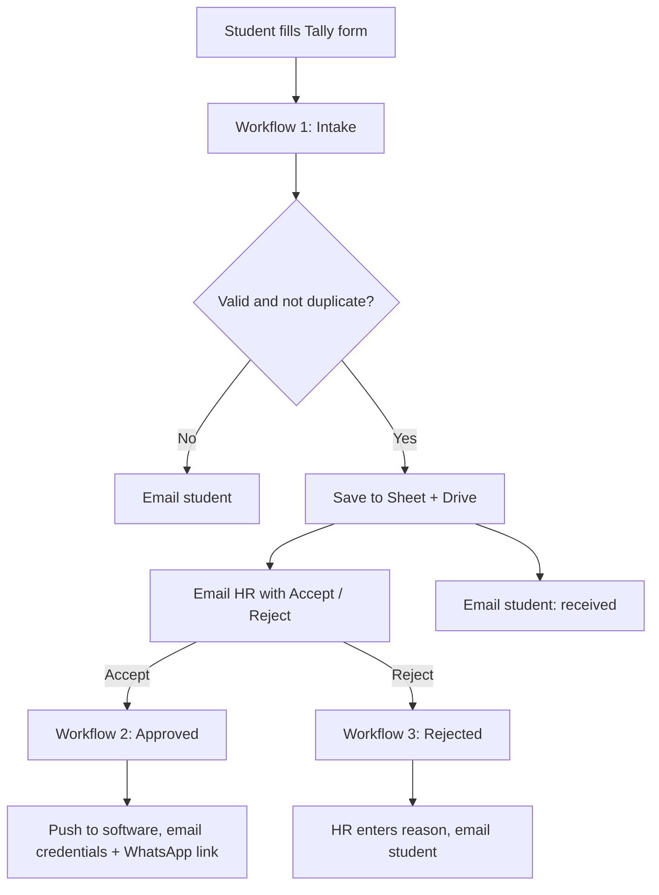

# Student Admission Automation (n8n)

An end-to-end admission workflow built on **n8n**, **Tally Forms**, **Google Sheets / Drive** and **Gmail**.

Students apply through a form. HR receives an email with every detail and the payment screenshot, and
accepts or rejects with one click. Everything else is automated: record keeping, sync to the existing
student software, portal credentials, the WhatsApp group invite and all notifications.
> **Demo video:** <div>
    <a href="https://www.loom.com/share/3de7c922bb4d4a9d9c97d654df1cbdd9">
      <p>Automating Client Intake, Approval, Rejection Workflows - Watch Video</p>
    </a>
    <a href="https://www.loom.com/share/3de7c922bb4d4a9d9c97d654df1cbdd9">
      
    </a>
  </div>

## Features

- Tally webhook intake with server-side validation (CNIC / B-Form, email, screenshot present)
- Duplicate detection (same CNIC and batch, unless the earlier application was rejected)
- Payment screenshots archived in a private Google Drive folder
- Application records in Google Sheets with a `pending`, `approved`, `rejected` lifecycle
- HR email with all data, the **embedded screenshot**, and **Accept / Reject** buttons
- Signed (HMAC-SHA256) links that cannot be guessed or forged
- Idempotent decisions: a second click never creates a second account
- Approval: push to the existing software, temporary credentials, batch WhatsApp link, welcome email
- Rejection: HR types a reason, the student gets a calm "we will contact you" email
- Failure handling: sync failures are flagged and alert the tech team; a global error workflow emails any crash

## Flow



## Repository structure

```
admission-automation/
├── README.md
├── workflows/                          Sanitized n8n workflow exports (JSON)
│   ├── 1-admission-intake.json
│   ├── 2-admission-approved.json
│   ├── 3-admission-rejected.json
│   └── error-handler.json
├── docker-compose.yml                  n8n + Postgres + Caddy
├── .env.example                        Placeholder environment variables
├── .gitignore
├── templates/
│   ├── google-sheet-template.xlsx      Applications, WhatsApp, Config, Test Log (+ Read Me)
│   ├── form-questions.md               Admission form and reject-form fields
│   └── emails/                         The four HTML email templates
│       ├── 1-application-received.html
│       ├── 2-hr-notification.html
│       ├── 3-approval-welcome.html
│       └── 4-rejection.html
└── docs/
    ├── setup-guide.md                  Step-by-step installation
    ├── architecture.md                 Design, diagrams, failure modes
    └── client-onboarding-checklist.md  Discovery to handover
```

## Quick start

```bash
git clone <this-repo> admission-automation && cd admission-automation
cp .env.example .env        # fill in domain and secrets (openssl rand -hex 32)
docker compose up -d        # n8n + Postgres + Caddy (HTTPS)
```

Then follow [`docs/setup-guide.md`](docs/setup-guide.md):

1. Upload `templates/google-sheet-template.xlsx` to Google Drive and convert it to a Google Sheet
2. Create Google and Gmail credentials in n8n
3. Import the four files in `workflows/`
4. Replace the placeholders (Sheet ID, Drive folder ID, base URL, emails, API URL)
5. Build the Tally form from `templates/form-questions.md` and add the webhook
6. Connect the client's software in the `Push to software` node
7. Activate the workflows and run the Test Log

## Workflows

| # | File | Trigger | Purpose |
|---|---|---|---|
| 1 | `1-admission-intake.json` | Tally webhook | Validate, de-duplicate, store, notify HR, confirm to student |
| 2 | `2-admission-approved.json` | HR clicks **Accept** | Lock, push to software, email credentials and WhatsApp link |
| 3 | `3-admission-rejected.json` | HR clicks **Reject** | Collect reason, mark rejected, email student |
| - | `error-handler.json` | Any workflow error | Email the tech team |

## Placeholders to replace

| Placeholder | Meaning |
|---|---|
| `YOUR_GOOGLE_SHEET_ID` | ID of the Admissions Google Sheet |
| `YOUR_DRIVE_FOLDER_ID` | ID of the private screenshots folder |
| `https://n8n.clientdomain.com` | Your public n8n URL |
| `hr@clientdomain.com`, `tech@clientdomain.com` | HR approver and technical alert addresses |
| `https://CLIENT-SOFTWARE.example.com/api/students` | Client software endpoint |
| `https://portal.clientdomain.com`, `+92-XXX-XXXXXXX`, `Your Institute` | Email template details |

## Security

- Decision links carry `HMAC-SHA256(LINK_SECRET, application_id)` and are verified before any change
- Status is checked and locked before side effects, so replays and double clicks are harmless
- Passwords are never written to the sheet. The temporary password exists only in the student's email.
- Secrets live in `.env` (git-ignored). The workflow exports contain no credentials.
- CNIC numbers and payment proofs are personal data: use HTTPS, restrict Sheet and Drive access, remove test data
- Optional: verify Tally's webhook signature (see the setup guide)

Known risk: some corporate email scanners open links automatically, which could trigger Accept or Reject
without a human click. Test with the real HR inbox before go-live.

## Documentation

| Doc | Contents |
|---|---|
| [Setup guide](docs/setup-guide.md) | Deploy, configure, import, test, back up, troubleshoot |
| [Architecture](docs/architecture.md) | Components, diagrams, design decisions, failure modes |
| [Client onboarding checklist](docs/client-onboarding-checklist.md) | Discovery, build, acceptance, handover |
| [Form questions](templates/form-questions.md) | Exact Tally labels and field mapping |

## Known limitations

- Google Sheets is a simple database. For high volume or many concurrent HR users, migrate to Postgres or Airtable.
- Tally dropdown options are managed in Tally, not in n8n.
- `Push to software` must be adapted to the client's actual system (API, database or import).
- Temporary passwords are emailed in plain text. Enforce a password change on first login if the portal supports it.
- Workflow exports target recent n8n 1.x versions. Node parameters can differ slightly between versions, so click through each node after importing.

## License

Add your preferred license and a `LICENSE` file. Note that **n8n** itself is distributed under the
[Sustainable Use License](https://docs.n8n.io/sustainable-use-license/), which is separate from this repository's license.
