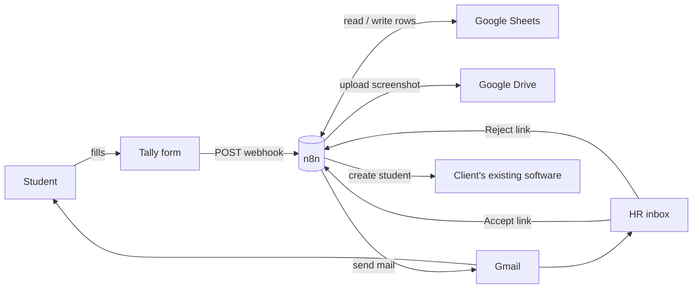
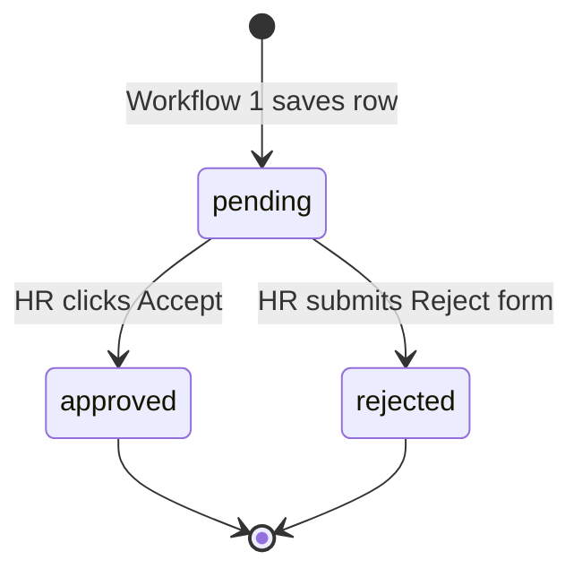
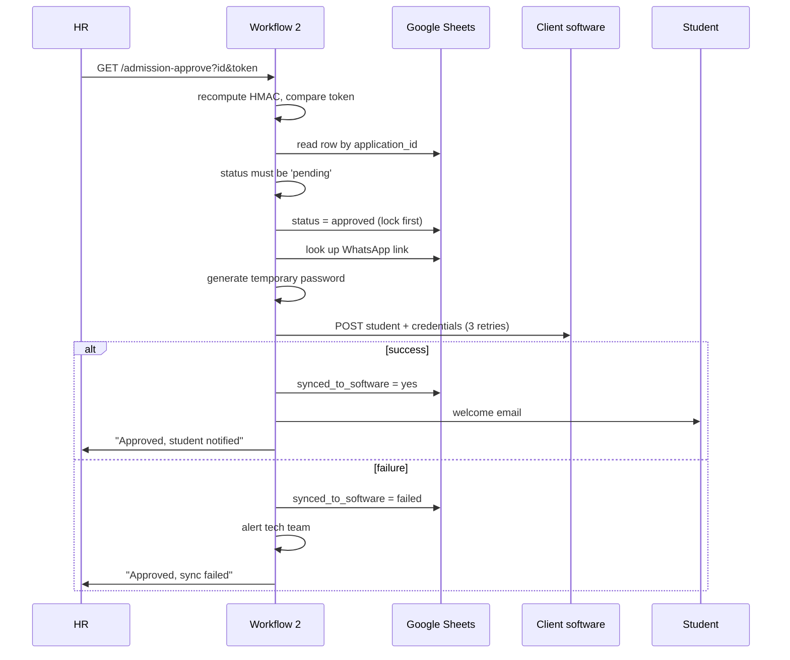

# Architecture

## Overview

## Components

| Component | Role | Notes |
|---|---|---|
| Tally | Public intake form | Sends a webhook on every submission |
| n8n | Orchestration | Three workflows plus an error handler |
| Google Sheets | System of record | Tabs: `Applications`, `WhatsApp`, `Config`, `Test Log` |
| Google Drive | Screenshot archive | Private folder, shared only with HR |
| Gmail | Notifications | Four HTML templates (`templates/emails/`) |
| Client software | Final destination | Integration depends on what it supports (API, DB, import) |
| Caddy | HTTPS reverse proxy | Automatic certificates |
| Postgres | n8n internal database | Workflows, credentials, execution history |

## Workflows

| # | File | Entry point | Purpose |
|---|---|---|---|
| 1 | `1-admission-intake.json` | Webhook `POST /webhook/tally-admission` | Validate, de-duplicate, store, notify HR, confirm to student |
| 2 | `2-admission-approved.json` | Webhook `GET /webhook/admission-approve` | Lock decision, push to software, email credentials |
| 3 | `3-admission-rejected.json` | Form `GET /form/admission-reject` | Collect reason, mark rejected, email student |
| - | `error-handler.json` | Error Trigger | Email the tech team when any workflow fails |

## Application lifecycle

A decision link only works while the row is `pending`. Once `approved` or `rejected`, further clicks show
"Already processed".

## Sequence: approval

## Key design decisions

| Decision | Reason |
|---|---|
| Own signed links instead of "Send and Wait" | Nothing sits paused in n8n for days; links survive restarts; HR gets a persistent record |
| HMAC-SHA256 token = `HMAC(LINK_SECRET, application_id)` | Links cannot be guessed or forged, and no token has to be stored |
| Lock status **before** calling the client software | A double click cannot create two accounts |
| Fields looked up by Tally **label**, not index | Reordering questions in Tally does not break the mapping |
| Passwords never written to the sheet | Reduces exposure; the email is the only place the temporary password appears |
| WhatsApp links in a sheet tab | The client adds new batches without opening n8n |
| `email_send` and `confirmation_send` columns | HR can see at a glance which notifications went out |
| Google Sheets as the database | Simple handover and visible to HR. Migrate to Postgres or Airtable for high volume |

## Data flow for personal data

| Data | Stored in | Retention guidance |
|---|---|---|
| CNIC / B-Form, name, email, city | Google Sheet | Delete or anonymise per the client's privacy policy |
| Payment screenshot | Tally (temporary URL) and private Drive folder | Keep only as long as needed for audit |
| Temporary password | Student's email only | Not stored anywhere else |
| n8n credentials | n8n database, encrypted with `N8N_ENCRYPTION_KEY` | Back up the key separately |

## Failure modes

| Failure | Behaviour |
|---|---|
| Invalid CNIC / email / missing screenshot | Student emailed the reason; no row created |
| Duplicate CNIC + batch | Student emailed; no new row |
| Tampered or expired link | "Invalid link" page; sheet unchanged |
| Link clicked twice | "Already processed" |
| Client software down | 3 retries, then `synced_to_software = failed`, alert email, student not emailed |
| Any other node error | Error Handler workflow emails the tech team |
| Email scanner pre-clicks a link | Possible with some corporate filters. Test with the real HR inbox; if it happens, point the buttons at a confirmation page |
